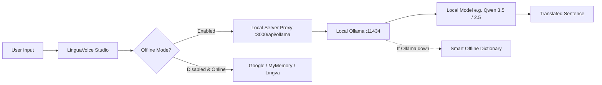

# LinguaVoice - Offline Package & Ollama LLM Guide

LinguaVoice is now fully packaged for **100% offline usage** powered by local Large Language Models (LLMs) via **Ollama**.

---

## 🚀 Quick Start (1-Click Run)

### On Windows
Simply double-click:
```bat
start-offline.bat
```
*(Or in PowerShell: `./start-offline.ps1`)*

### On macOS / Linux
Open a terminal in the project directory and run:
```bash
chmod +x start-offline.sh
./start-offline.sh
```

### Or using Node.js directly
```bash
npm start
```
The server starts at **`http://localhost:3000`** and automatically opens your web browser.

---

## 🧠 How Offline LLM Translation Works



1. **Zero Cloud Requirement**: When **Offline LLM Mode** is toggled ON, translation requests are sent directly to your local Ollama daemon.
2. **Strict Offline Mode**: Toggle **"Strict Offline (100% Air-Gapped)"** in the top bar to block all external internet requests completely.
3. **Automatic Model Detection**: The app automatically detects models installed in your local Ollama (e.g., `qwen3.5:4b`, `qwen2.5:3b`, `llama3.2`, etc.) and lets you switch between them on the fly.
4. **Offline Dictionary Fallback**: If Ollama is temporarily stopped, common phrases automatically fall back to the built-in bidirectional 25-language offline dictionary.

---

## 🌐 Supported Languages (All 25 Can Run Offline)

| Category | Languages |
| :--- | :--- |
| **Indian Languages (10)** | Tamil (`ta`), Hindi (`hi`), Telugu (`te`), Kannada (`kn`), Malayalam (`ml`), Bengali (`bn`), Marathi (`mr`), Gujarati (`gu`), Punjabi (`pa`), Urdu (`ur`) |
| **Global & European (8)** | English (`en`), French (`fr`), German (`de`), Spanish (`es`), Italian (`it`), Portuguese (`pt`), Russian (`ru`), Dutch (`nl`) |
| **East & Southeast Asian (5)**| Chinese (`zh-CN`), Japanese (`ja`), Korean (`ko`), Vietnamese (`vi`), Indonesian (`id`) |
| **Middle East (2)** | Arabic (`ar`), Turkish (`tr`) |

---

## 📦 Recommended Models for Offline Translation

You can install any of the following models in Ollama depending on your hardware:

### 1. `qwen2.5:3b` (Recommended for Laptops & Fast CPU Translation)
- **Size**: ~2.0 GB
- **Speed**: Very fast (~1-2 seconds per sentence on CPU)
- **Indic & Global Quality**: Excellent accuracy across Tamil, Telugu, Hindi, Malayalam, and 20+ other languages without reasoning overhead.
- **Install command**:
  ```bash
  ollama run qwen2.5:3b
  ```

### 2. `qwen3.5:4b` (Currently Installed & Active)
- **Size**: ~3.3 GB
- **Quality**: Advanced reasoning and multi-turn precision.
- **Install command**:
  ```bash
  ollama run qwen3.5:4b
  ```

### 3. `qwen2.5:7b` (Best Quality if you have 8GB+ RAM / GPU)
- **Size**: ~4.7 GB
- **Quality**: Production-grade translation across all 25 languages.
- **Install command**:
  ```bash
  ollama run qwen2.5:7b
  ```

---

## 🔊 Offline Voice / Speech Playback (TTS)

LinguaVoice uses the browser's native **Web Speech API** (`window.speechSynthesis`), which relies on operating system voices:

- **English, Spanish, French, German, Chinese, Hindi**: Usually pre-installed and work offline immediately.
- **Regional Languages (Tamil, Telugu, Kannada, Malayalam, etc.)**:
  To enable offline voice on Windows:
  1. Open **Windows Settings** (Win + I).
  2. Go to **Time & Language** > **Language & Region**.
  3. Click **Add a language** and search for your language (e.g. *Tamil (India)*, *Telugu (India)*).
  4. Ensure the **"Speech recognition & Text-to-speech"** feature checkbox is checked and installed.
  5. Restart your browser. LinguaVoice will automatically list the new offline natural voices in the **Voice Model** dropdown!

---

## 📁 Packaging for Distribution / Sharing

To share this project as a downloadable offline package:
1. You can zip the entire `Translator-25-Lingua` folder.
2. The recipient needs only:
   - [Node.js](https://nodejs.org/) (installed once)
   - [Ollama](https://ollama.com/) (with at least one model, e.g. `ollama pull qwen2.5:3b`)
3. They simply double-click `start-offline.bat` to run!
